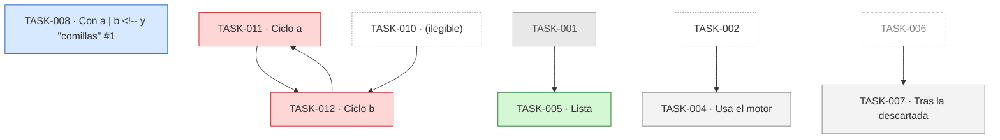
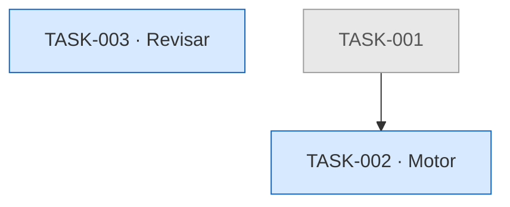

# Roadmap de tareas

<!-- generado por tc2; formato 2; no editar fuera de la zona manual -->

<!-- manual:inicio (a mano) -->
## Hitos

### H2 — Dos
El motivo.
### H1 — Uno
### H3 — Tres
<!-- manual:fin -->

## Estado del trabajo

Orden en que se hacen las tareas: ninguna va antes que aquellas de las que depende y, a igualdad, va primero la del hito anterior (en el orden de los `### Hn — título` de la zona manual) y luego la de número menor. tc2 lo regenera en cada cambio de la rama de estado; solo la zona manual se edita a mano.

- **En marcha:** TASK-008 (en diseño), TASK-002 (en curso), TASK-003 (en revisión)
- **Listas para empezar:** TASK-005
- **Atascadas (ciclo):** TASK-011, TASK-012
- **Ilegibles:** TASK-010
- **Dependencias inexistentes:** TASK-007>TASK-099
- **Dependen de una descartada:** TASK-007>TASK-006

## En curso

| Tarea | Título | Con quién | Hito | Depende de |
|---|---|---|---|---|
| TASK-008 | Con a \| b &lt;!-- y "comillas" #1 | alguien de fuera | H2 | — |
| TASK-002 | Motor | @ana | H1 | TASK-001 |

## En revisión

| Tarea | Título | Con quién | Hito | Depende de |
|---|---|---|---|---|
| TASK-003 | Revisar | @ana-x | H1 | — |

## H2 — Dos

0 de 6 terminadas.

| Paso | Tarea | Título | Depende de | Estado | Con quién |
|---|---|---|---|---|---|
| 1 | TASK-007 | Tras la descartada | TASK-006, TASK-099 | espera a TASK-006 (descartada) | — |
| 2 | TASK-008 | Con a \| b &lt;!-- y "comillas" #1 | — | en diseño | alguien de fuera |
| 4 | TASK-005 | Lista | TASK-001 | lista para empezar | — |
| 6 | TASK-004 | Usa el motor | TASK-002 | espera a TASK-002 | — |
| — | TASK-011 | Ciclo a | TASK-012 | atascada (ciclo) | — |
| — | TASK-012 | Ciclo b | TASK-011, TASK-010 | atascada (ciclo) | — |

## H1 — Uno

1 de 3 terminadas.

| Paso | Tarea | Título | Depende de | Estado | Con quién |
|---|---|---|---|---|---|
| 5 | TASK-002 | Motor | TASK-001 | en curso | @ana |
| 7 | TASK-003 | Revisar | — | en revisión | @ana-x |

## Terminadas

Total: 2.

Ver la lista

- TASK-001 — Base (H1)
- TASK-009 — Cerrada (H3)

## Descartadas

Total: 1.

Ver la lista

- TASK-006 — Ya no (H2) — motivo: ya no hace falta

